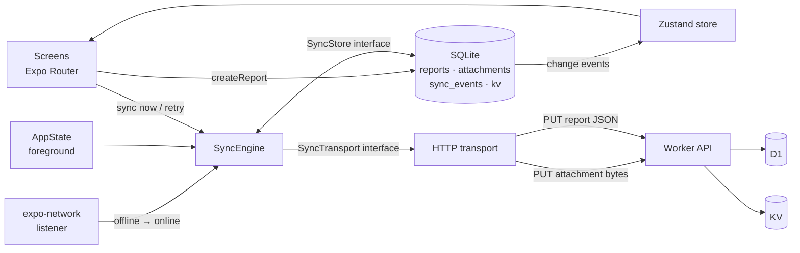

# Field Capture: offline-first site reporting

A React Native + TypeScript app for capturing field reports on construction sites with **no connectivity**. Reports (text, photos, a voice note, GPS) are saved to SQLite on the device first, then a background **sync engine** uploads them when the network returns. Each report shows its state: `Pending → Syncing → Synced`, or `Error` with automatic and manual retry.

| | |
|---|---|
| **Mobile** | Expo SDK 58 · React Native 0.88 · TypeScript (strict) · Expo Router · expo-sqlite · Zustand · Reanimated |
| **Server** | Cloudflare Workers · Hono · D1 (SQLite) for metadata · Workers KV for media |
| **Quality** | 16 unit tests for the sync engine · strict TS · ESLint · GitHub Actions CI |

---

## What it does

- **Capture offline**: title, notes, category, severity, up to 6 photos (camera or gallery), a voice note, and a GPS fix. GPS needs no data connection.
- **Persist locally**: SQLite is the source of truth. Data survives app kills and reboots. Media is moved out of the OS cache into the app's document directory so it cannot be purged before upload.
- **Draft autosave**: the form is persisted as you type. If the app dies mid-capture, the draft (including photos) is restored.
- **Sync status per report**: `pending`, `syncing`, `synced`, `error`, shown on every list, the dashboard, the Sync Center and a per-report activity timeline.
- **Automatic sync on reconnect**: driven by OS network events. A captive portal or Wi-Fi with no internet is not counted as online.
- **Retry**: exponential backoff for transient failures, an immediate retry when connectivity returns, and manual **Retry** / **Retry all**.
- **Developer tools** (Settings): simulate a server outage (503) or add latency, to demonstrate the failure and retry paths.

## Architecture



```
mobile/src
├── app/                 # Routes (Expo Router): tabs, report/new (modal), report/[id]
├── sync/
│   ├── syncEngine.ts    # Platform-agnostic engine: no React Native imports, fully unit-tested
│   ├── httpTransport.ts # Idempotent PUTs with timeouts, error classification
│   ├── backoff.ts, errors.ts
│   └── __tests__/       # Engine tests against in-memory fakes
├── db/                  # Migrations (PRAGMA user_version), repositories, change notifications
├── services/            # Bootstrap, media persistence, location, drafts, report actions
├── state/               # Zustand store (read model for the UI)
├── components/ theme/ domain/ utils/
server/src               # Hono app: idempotent upserts, fault injection, read-only web inbox
```

## The sync engine: design decisions

The engine (`mobile/src/sync/syncEngine.ts`) implements an **outbox** over SQLite. These decisions matter most:

| Problem | Approach |
|---|---|
| **Duplicate uploads.** The response is lost after the server has already stored the data. | Report and attachment IDs are **UUIDs generated on the device**. The server uses `PUT` with an upsert keyed by that ID, so a resend overwrites the same row. The server counts deliveries (`delivery_count`) to show that retries were deduplicated, not duplicated. |
| **App killed mid-upload** leaves rows stuck in `syncing`. | On startup, `recoverInterrupted()` returns them to `pending` and logs a `recovered` event. |
| **Concurrent triggers** (reconnect, foreground and "sync now" at the same moment). | Single-flight: one run at a time. Triggers that arrive mid-run join it, plus at most one follow-up pass. |
| **Large attachments on flaky networks.** | Attachments upload one by one, and each acknowledgement is recorded (`attachments.uploaded`). A retry resends only what the server hasn't confirmed. The report metadata goes last. |
| **Server lost an attachment.** | The report `PUT` validates that every referenced attachment exists, or returns `409`. The client clears its upload flags and resends them all. |
| **Retrying things that will never work.** | Errors are classified. Network, timeout, 5xx/408/429 and 409 are **retryable** (backoff 5 s → 10 s → … capped at 5 min, ±20 % jitter). Other 4xx errors and missing local files are **permanent**: shown as `Error`, never auto-retried, and the user can still retry manually. |
| **Hammering a dead connection.** | A connectivity failure stops the batch, so the remaining reports stay `pending` and keep their attempt budget. |
| **Waiting out backoff after the network returns.** | On an offline → online transition, every retryable error becomes due immediately. |
| **"Connected" but no internet** (captive portal). | Online means `isConnected && isInternetReachable !== false`. On Android the latter requires the OS's validated-internet capability. The engine also treats any network error as a connectivity failure, so a wrong reading still fails safely. |

The engine depends only on two interfaces, `SyncStore` and `SyncTransport`, so its tests run in plain Jest with an in-memory store and a scriptable transport. No device or network is needed.

## Running it

### Server (Cloudflare Workers)

```bash
cd server
npm install
npx wrangler login
npx wrangler d1 create sledge-field-capture          # put the id in wrangler.jsonc
npx wrangler kv namespace create FILES               # put the id in wrangler.jsonc
npm run db:migrate:remote
npm run deploy                                       # prints https://sledge-field-capture.<you>.workers.dev
```

Local development: `npm run db:migrate:local && npm run dev`, which serves on `http://localhost:8787`.
Open the Worker URL in a browser to see the **server inbox**, which polls every 3 s and shows reports, photos and voice notes as they arrive.

| Endpoint | |
|---|---|
| `PUT /v1/reports/:id/attachments/:attachmentId` | Raw bytes. Headers: `content-type`, `x-attachment-kind: photo\|audio`. Idempotent. |
| `PUT /v1/reports/:id` | JSON report. Idempotent upsert. Returns `409` if attachments are missing. |
| `GET /v1/reports` · `GET /files/:id` · `GET /health` | Read side, used by the inbox page. |

Fault injection (sent by the app's developer toggles): `x-simulate-failure: 1` returns `503`; `x-simulate-delay: <ms>` adds latency (max 5 s).

### Mobile

```bash
cd mobile
npm install
cp .env.example .env            # set EXPO_PUBLIC_API_URL to your Worker URL
npx expo start                  # dev (Expo Go or a development build)
npm test                        # sync engine unit tests
npm run typecheck && npx expo lint
```

**Installable APK** (needed for the offline demo; Expo Go needs the dev server to reload):

```bash
npx eas-cli@latest build -p android --profile preview
```

The server URL can also be changed at runtime under **Settings → Sync server**.

## Trade-offs and next steps

Deliberately out of scope for a prototype:

- **Authentication.** The API is open. Next: device enrolment and a signed token per request.
- **Editing synced reports and conflict resolution.** Reports are immutable once captured, which suits field evidence. Supporting edits would need a version column with last-write-wins or a field-level merge.
- **Sync while the app is closed.** Sync runs while the app is in the foreground or resumes. Next: `expo-background-task` to drain the outbox periodically.
- **Large media.** Photos are downscaled to 1600 px JPEG (about 300 KB) and voice notes are mono AAC. Video would need chunked or resumable uploads.
- **End-to-end tests.** A Maestro flow covering airplane mode, capture, kill, relaunch and sync.
- **Pagination.** The list loads all reports, which is fine for thousands of rows on a device; very large histories would page from SQLite.
